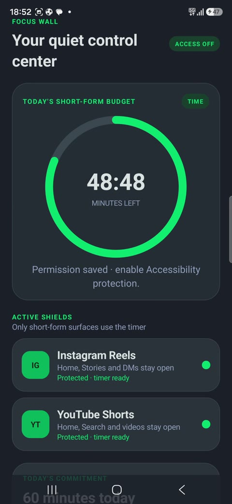

<div align="center">

# Focus Wall

### Stay connected. Scroll with intention.

**A local-first Android accessibility utility that puts a daily boundary around native Instagram Reels and YouTube Shorts—without replacing the apps you already use.**

[](#build)
[](#build)
[](#privacy--security)
[](#see-it-work)

[See it work](#see-it-work) · [What it protects](#what-focus-wall-changes) · [Build it](#build) · [Security](SECURITY.md)

</div>

> **Status:** v1.3.0 personal beta · tested on Android 16 / Samsung SM-S711B. Third-party apps change often; test every new Focus Wall build on your own device.

## See it work

[](docs/media/focus-wall-guide.mp4)

*An 18-second, privacy-safe product guide. It contains only Focus Wall screens—no messages, account picker, social feed, or personal media.*

## The promise

Social apps are useful for people, messages, stories, posts, and search. Infinite vertical video is a different experience. Focus Wall preserves the first group and puts a daily, intentional boundary around the second.

| Keep using your apps | Focus Wall changes only this |
| --- | --- |
| Instagram Home, DMs, Stories, notifications, posts, profiles, and search | The native Reels tab uses a daily budget from **0–60 minutes** |
| YouTube search, regular videos, subscriptions, and Home | YouTube Shorts use that same daily budget |
| Your existing Instagram / YouTube login | No proxy login, alternate feed, or account password is requested |

## What Focus Wall changes

```text
Instagram / YouTube
        │
        ├─ Home · DMs · Stories · Posts · Search ─────────────── stays native
        │
        └─ Reels / Shorts ── daily timer ── budget reached ── calm limit card
```

- **Timer integrity:** time is counted only while Focus Wall detects native Reels or Shorts—not while you are in Home, DMs, Stories, or away from the app.
- **No forced Back loop:** hitting the limit presents a clear card instead of repeatedly pressing Back or closing the entire app.
- **Shared content remains useful:** a Reel opened from a DM or Story can be viewed; advancing into the endless feed is held back when the daily budget is gone.
- **Intentional setup:** onboarding asks who the boundary is for, what they want more of, and uses a press-and-hold commitment before arming a daily limit.
- **0-minute mode:** choose zero when you want no Reels or Shorts feed that day while keeping the rest of your social apps usable.

## Privacy & security

Focus Wall is built around one constraint: it should never become more invasive than the habit it helps manage.

- **Local-first state.** The daily timer and settings are stored in the app’s private Android preferences. Android backup and device-transfer extraction are disabled.
- **No social-media credentials.** Focus Wall does not read, store, or submit Instagram or YouTube passwords, messages, media, or account data.
- **No advertising or analytics.** There are no ad or analytics SDKs in the app.
- **Optional Google identity.** Google sign-in is opt-in and currently provides identity only; cloud backup is not implemented. The blocker works completely without an account.
- **Small Android surface.** The accessibility service and limit activity are non-exported; the launcher is the only public component.

Read the full [security policy](SECURITY.md) before distributing a build.

## Build

```bash
git clone https://github.com/Abhyuday007/focus-wall.git
cd focus-wall
./gradlew :app:assembleDebug
./gradlew :app:installDebug
```

Enable **Focus Wall app blocker** under Android’s Accessibility settings after installing. The app needs that user-granted permission to notice the active Reels and Shorts surfaces; it does not use it to read or alter social-app content.

### Optional Firebase account setup

The repository intentionally excludes `app/google-services.json`, signing keys, and local Android configuration. A public clone builds and runs without them.

To enable optional Google sign-in for your own Firebase project:

1. Register `dev.focuswall` in Firebase.
2. Enable Firebase Authentication → Google.
3. Add debug and release SHA-1 certificate fingerprints.
4. Put your project-specific `google-services.json` in `app/`.

Cloud backup is deliberately not enabled yet. Do not add one without per-account security rules and an explicit data model.

### Signed release

```bash
./scripts/build-release.sh
```

The release script retrieves a locally held signing password from macOS Keychain and produces a signed APK. Never commit a `.jks`, `.keystore`, `local.properties`, `google-services.json`, or signing password.

## Scope

Focus Wall is an independent Android project. It is not affiliated with, endorsed by, or sponsored by Meta, Instagram, Google, or YouTube. It is a personal attention tool—not a substitute for medical, mental-health, or parental-control advice.
