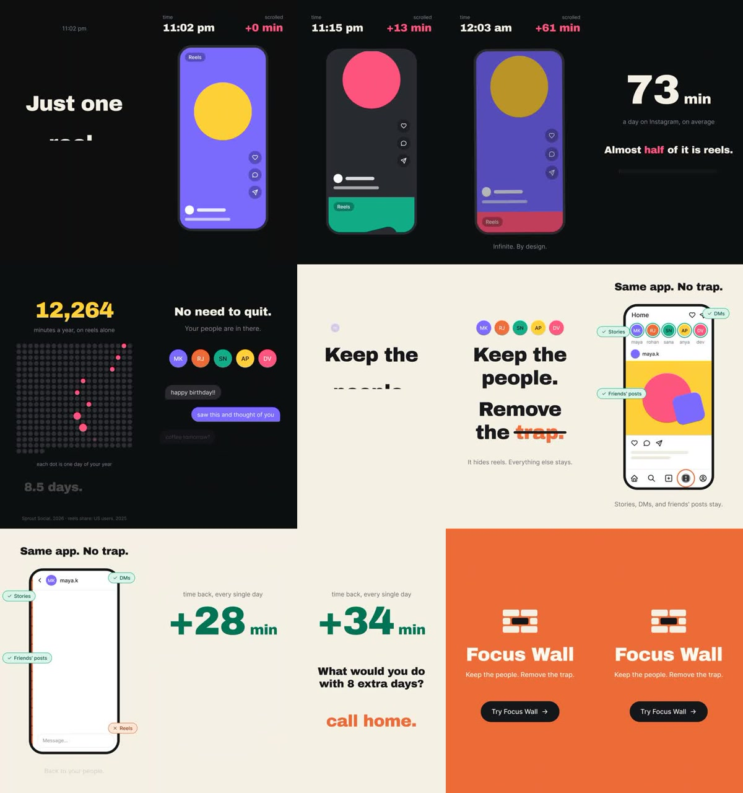

# Focus Wall brand guide

## Core idea

Focus Wall is not about quitting social media. It keeps the useful, human parts of Instagram and YouTube available while putting an intentional wall in front of the infinite feed.

**Primary line:** Keep the people. Remove the trap.

**Supporting line:** Same app. No trap.

## Visual system

| Role | Colour | Hex |
| --- | --- | --- |
| Signal | Focus orange | `#F36B38` |
| Light canvas | Warm paper | `#F5EFE3` |
| Light surface | Soft cream | `#FFF9F0` |
| Ink | Near black | `#151512` |
| Protected state | Safe green | `#087F5B` |
| Dark canvas | Deep charcoal | `#11120F` |

- Use the brick-wall mark as the primary symbol. Preserve the central dark brick on orange and cream applications.
- Use large, direct, editorial headlines. Android currently uses the system `sans-serif-black` face so the app remains dependency-free.
- Use orange to signal the boundary, black for primary actions, and green only to confirm that protection is working.
- Prefer warm paper and cream over pure white. Prefer deep charcoal over pure black in dark mode.
- Motion should feel physical: bricks build, counters settle, and cards rise gently. Avoid frantic bouncing or feed-like motion.

## Voice

- Human, direct, calm and slightly defiant.
- Lead with what remains available: people, DMs, Stories, search and normal videos.
- Describe the wall as a boundary chosen by the user, never as punishment.
- Do not claim that Focus Wall removes every Reel. Shared Reels and the user’s chosen daily allowance remain intentionally available.
- Do not describe Accessibility as surveillance. Explain exactly what is processed locally and what is never read or collected.

## Campaign reference

The collaborator-created vertical concept film supplied on 24 November 2026 is the visual reference for future campaigns. Preserve the original master separately and use this storyboard when adapting it to new formats.

Before publishing statistics from the concept film, verify the source, geography, date range and calculation. Product demonstrations must use real Focus Wall screens or be clearly labelled as conceptual.
